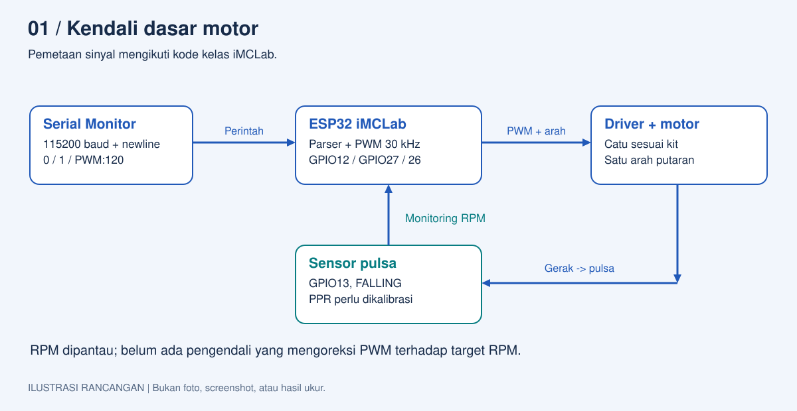
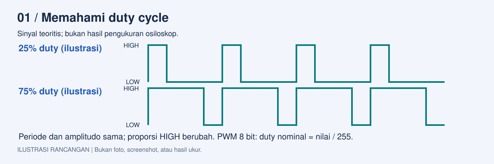
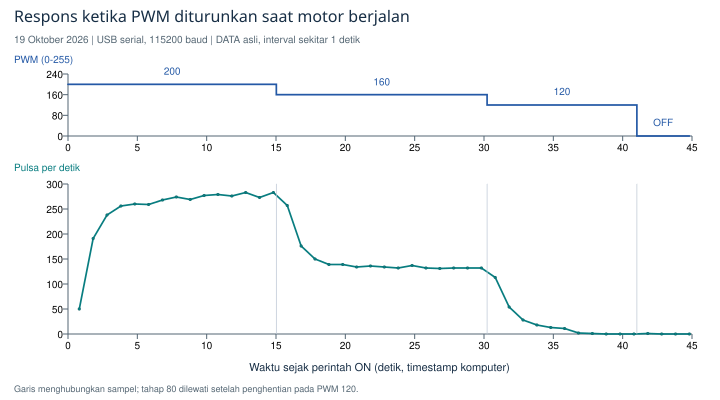
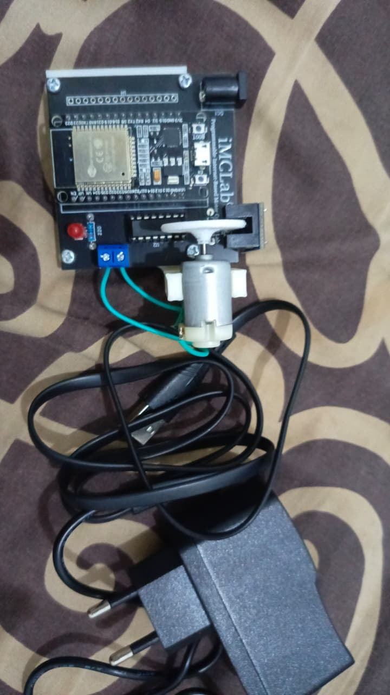
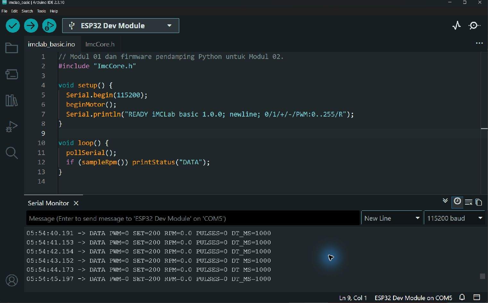

# Modul 01 - Kendali Dasar Motor DC pada Kit iMCLab

Identitas: [identitas mahasiswa](../IDENTITAS.md). Tanggal eksperimen: **18-19 Oktober 2026**.

Status laporan: **Data kit dan pengamatan operator sudah dicatat. Identitas mahasiswa lengkap; kalibrasi RPM dan pemeriksaan lanjutan tetap dicatat objektif.**

## Ringkasan riset

Eksperimen menguji perintah serial, ON/OFF, dan variasi PWM pada motor DC Kit iMCLab. Firmware mengikuti pemetaan pin materi kelas, dengan setpoint terpisah dari status motor dan pencatatan pulsa sensor. Komunikasi USB serta pengujian parser berhasil. Motor dapat mulai tanpa bantuan pada beberapa tes PWM 200, tetapi gagal pada tes lain. Pada pengujian PWM yang diturunkan saat motor berjalan, rata-rata lima sampel akhir adalah 278,8 pulsa/detik pada PWM 200 dan 131,8 pulsa/detik pada PWM 160. Pada PWM 120, pulsa turun sampai nol dan tes dihentikan. Temuan ini menunjukkan respons yang bergantung pada kondisi awal; penyebab ketidakkonsistenan start belum terverifikasi. RPM masih merupakan estimasi dengan asumsi dua pulsa per putaran.

## Tujuan

1. Memverifikasi komunikasi komputer-ESP32 dan perintah ON/OFF.
2. Mengamati kemampuan start dan respons motor terhadap PWM.
3. Menyusun analisis berdasarkan data serial serta pengamatan fisik operator.

## Alat dan kondisi uji

| Komponen | Kondisi yang dicatat |
| --- | --- |
| Kit dan mikrokontroler | iMCLab; esptool mendeteksi ESP32-D0WDQ6 revisi v1.0. Revisi PCB dan tipe IC driver belum dikonfirmasi. |
| Catu dan mekanik | Adaptor bawaan berlabel 5 V, 2 A menurut operator; tegangan berbeban belum diukur. Kit di meja, piringan bebas bergerak. |
| Perangkat lunak | Arduino IDE 2.3.10, ESP32 core 2.0.17, firmware imclab_basic 1.0.0. |
| Komunikasi | USB serial COM5, 115200 baud, satu perintah per baris. |
| Pemetaan dan sensor | LED GPIO 2; IN1 27; IN2 26; PWM 12; sensor GPIO 13, FALLING, asumsi PPR=2. |

Variabel bebas adalah status ON/OFF dan setpoint PWM. Variabel terikat adalah pulsa per interval, RPM estimasi, dan gerak yang diamati. Arah, catu yang digunakan, dan beban tidak sengaja diubah, tetapi tegangan, arus, dan suhu tidak direkam sehingga kestabilannya belum dapat dijamin.

<!-- pagebreak -->

## Dasar teori dan alur program

PWM 8 bit menggunakan nilai 0-255. Duty nominal adalah `PWM/255 x 100%`; PWM 200 setara 78,43%. Duty tidak sama dengan persentase kecepatan motor. Konsep PWM mengikuti E-book Jilid 1, Bab 3, PDF halaman 60-65; pin dan frekuensi motor mengikuti kode kelas `on_off_Motor.ino` dan `imclab_naik_turun.ino`.



**Gambar 1.** Ilustrasi rancangan. ESP32 menerjemahkan perintah serial menjadi PWM 30 kHz dengan arah tetap. Pulsa sensor dipakai untuk monitoring, belum untuk koreksi otomatis terhadap target RPM; sistem masih menggunakan kendali loop terbuka.



**Gambar 2.** Ilustrasi teoritis duty cycle; bukan hasil osiloskop. Keluaran nyata pada driver dan motor belum diukur secara elektrik.

Setpoint disimpan terpisah dari status ON/OFF. `PWM:200` saat OFF menghasilkan `PWM=0 SET=200`. Perintah `1` mengaktifkan keluaran dan `0` mematikannya. LED biru mengikuti perintah keluaran sehingga tidak membuktikan poros berputar. Program menolak nilai di luar 0-255 dan perintah tidak dikenal.

RPM dihitung sebagai `N x 60000 / (PPR x dt_ms)`. Penghitung pulsa memakai critical section, interval aktual, dan debounce 500 mikrodetik. Asumsi PPR=2 belum diperiksa terhadap poros aktual; hasil utama laporan karena itu disajikan sebagai laju pulsa.

<!-- pagebreak -->

## Metode dan pencatatan

Pengujian USB dilakukan 18 Oktober 2026. Rangkaian motor dan parser dilakukan 19 Oktober 2026, sekitar 00:50-01:22 WIB. Pengiriman perintah otomatis menggunakan komputer; pengamatan gerak dilakukan operator. Log menyimpan timestamp, TX, ACK, dan DATA. Bantuan memutar poros hanya dilaporkan pada percobaan manual terpisah, bukan pada rangkaian otomatis yang berhasil.

1. Uji OFF: kirim `0` dan `R`, lalu periksa keluaran dan telemetri.
2. Uji awal: PWM 120 sekitar 5 detik, PWM 200 sekitar 2 detik, lalu tiga pengulangan PWM 200 sekitar 5 detik.
3. Variasi dari diam: mulai dari OFF untuk PWM 80, 120, 160, dan 200. Rencana 15 detik dihentikan dini jika tidak ada pulsa selama 3 detik.
4. Pemeriksaan ulang: PWM 200 tetap gagal pada satu tes, kemudian berhasil pada tes sekitar 2 detik pukul 01:19; operator mengonfirmasi start tanpa bantuan dan berhenti setelah OFF.
5. Variasi saat berjalan: mulai sekali pada PWM 200, lalu turunkan ke 160, 120, dan rencana 80, masing-masing 15 detik. Motor tetap diaktifkan antartahap. Pemantauan menghentikan tes saat pulsa hilang selama 3 detik.
6. Uji parser saat OFF: target 0/200/255, `+`, `-`, status, dan penolakan `PWM:256` serta `abc`. PWM 255 tidak digunakan untuk menjalankan motor.

Kriteria ringkasan ditetapkan saat analisis: ambil lima DATA terakhir dari fase 15 detik yang selesai, dengan seluruh jendela sampel melewati lima detik pertama fase, pulsa positif, dan rentang maksimum-minimum tidak melebihi 5% rata-rata. Ini kriteria deskriptif, bukan jaminan keadaan tunak sistem. ACK/STATUS tidak dihitung sebagai sampel tambahan. Sampel pertama setelah pergantian PWM dapat memuat kondisi sebelumnya.

## Hasil awal dan konsistensi start

| Skenario | Durasi ON | Hasil sensor | Pengamatan/keterangan |
| --- | --- | --- | --- |
| Awal PWM 120 | 5,068 s | Semua pulsa nol | Operator melihat motor tetap diam. |
| Pilot PWM 200 | 2,150 s | 82 lalu 199 pulsa | Operator melihat berputar lalu berhenti. |
| PWM 200, ulangan 1-3 | 5,067-5,167 s | Maksimum 259; 259; 274 pulsa per jendela | Pulsa meningkat, lalu turun setelah OFF. Operator mengonfirmasi tidak membantu putaran tes otomatis. |
| Start 80, 120, 160, 200 | 3,091-3,134 s per kondisi | Semua pulsa nol | Penghentian dini; operator tidak mengamati seluruh rangkaian. |
| Ulang PWM 200 pukul 01:00 | 3,198 s | Semua pulsa nol | Motor diam, LED berubah menurut operator. |
| Ulang PWM 200 pukul 01:19 | 2,024 s | 0 lalu 84 pulsa | Operator mengonfirmasi mulai sendiri dan berhenti. |

Durasi adalah jarak timestamp perintah ON-OFF pada komputer, bukan waktu gerak mekanis. Seluruh interval DATA dalam log ini adalah 1000 ms. Daftar berkas dan angka rinci ada pada [indeks log](data/ringkasan_log.md).

<!-- pagebreak -->

## Hasil variasi PWM saat berjalan



**Gambar 3.** Grafik log 19 Oktober 2026 pukul 01:21:35-01:22:20 WIB. Grafik atas menunjukkan PWM yang diperintahkan, grafik bawah laju pulsa dari DATA. Garis menghubungkan sampel, bukan pengukuran kontinu. Setelah pulsa hilang pada PWM 120, keluaran diperintahkan OFF; tahap 80 tidak dijalankan.

| PWM | Durasi fase | Rata-rata pulsa/detik | RPM estimasi (PPR=2) | Sampel terpilih |
| --- | --- | --- | --- | --- |
| 200 | 15,024 s | 278,8 | 8.364 | 5 |
| 160 | 15,199 s | 131,8 | 3.954 | 5 |
| 120 | 10,802 s; dihentikan dini | Tidak diringkas sebagai putaran stabil | Tidak ditetapkan | 0 |
| 80 | Tidak dijalankan pada rangkaian ini | Tidak tersedia | Tidak tersedia | 0 |

Pada lima sampel terpilih, rentang relatif PWM 200 adalah 3,59% dan PWM 160 adalah 0,76%, sehingga keduanya memenuhi kriteria deskriptif. Simpangan baku sampel laju pulsa masing-masing 4,38 dan 0,45 pulsa/detik; angka ini tidak mewakili ketidakpastian kalibrasi sensor.

Operator mengonfirmasi motor mulai sendiri, kemudian melambat dan berhenti tanpa bantuan tangan. Pada PWM 120, pulsa turun dari 113 pada jendela transisi menjadi 54, 28, 18, 13, 11, 2, 1, lalu tiga sampel nol. Satu pulsa muncul pada sampel pertama setelah OFF; itu tidak cukup untuk membuktikan motor kembali berputar dan dapat berkaitan dengan transisi, gerak sisa, atau pembacaan sensor.

Uji parser menghasilkan 10 pemeriksaan yang sesuai respons diharapkan. Nilai 256 dan input `abc` ditolak, sedangkan `+`/`-` mengubah target 10 satuan. Seluruh respons saat uji parser menunjukkan PWM=0. Log mentah tersedia bersama [hasil analisis](data/hasil_analisis.json) dan [sampel DATA](data/sampel_serial.csv).

<!-- pagebreak -->

## Pembahasan dan simpulan

Motor dapat mulai pada PWM 200, tetapi keberhasilan start belum konsisten. Peristiwa gagal start tidak dihapus karena uji berikutnya berhasil. Operator melaporkan bahwa pada percobaan manual motor dapat berjalan setelah diberi putaran awal; pengamatan tersebut belum disertai log kuantitatif dan tidak digunakan menghitung rata-rata.

Pada rangkaian saat berjalan, penurunan setpoint dari 200 ke 160 sebesar 20% diikuti penurunan rata-rata laju pulsa sekitar 52,7%. Dua titik dari satu rangkaian ini menunjukkan respons yang tidak sebanding pada kondisi uji tersebut, tetapi belum cukup untuk menetapkan model umum PWM-kecepatan.

PWM 160 dapat mempertahankan putaran setelah diturunkan dari 200, walaupun tes start dari diam sebelumnya tidak menghasilkan pulsa. Ini menunjukkan pentingnya menyebut kondisi awal. Dugaan pengaruh gesekan, torsi awal, catu, driver, atau posisi rotor belum dapat dipilih sebagai penyebab tanpa pemeriksaan lanjutan. Tidak ada hasil yang membuktikan kerusakan tertentu maupun menjamin seluruh perangkat normal.

Kesimpulan: komunikasi serial, perubahan target, dan ON/OFF berhasil digunakan pada kit. Data nyata menunjukkan putaran pada PWM 200 dan 160 saat berjalan, serta hilangnya putaran pada rangkaian PWM 120. Ambang start minimum dan hubungan PWM-RPM menyeluruh belum dapat ditetapkan. Kalibrasi pulsa per putaran, pengulangan kondisi, serta pengukuran catu diperlukan bila akan membangun model kendali lebih lanjut.

## Dokumentasi kit dan indikator



**Gambar 4.** Foto asli kit yang diberikan operator sebelum rangkaian uji. Terlihat ESP32, motor, piringan, sensor, dan adaptor. Foto ini merupakan identifikasi perangkat; bukan dokumentasi susunan kit di meja saat pengukuran.

Indikator menurut pengamatan operator: hijau yang selalu menyala menunjukkan catu adaptor, hijau berkedip mengikuti deteksi sensor RPM, merah menunjukkan USB, dan biru mengikuti perintah ON. Fungsi tersebut dicatat sebagai keterangan operator, bukan hasil pengukuran skema listrik. Foto susunan praktik di meja masih perlu ditambahkan.

<!-- pagebreak -->

## Bukti Serial Monitor dan jejak data



**Gambar 5.** Screenshot asli setelah rangkaian uji: tab imclab_basic.ino, ESP32 Dev Module di COM5, New Line, dan 115200 baud. Seluruh sketch terlihat. Telemetri menunjukkan PWM=0, SET=200, RPM=0.0, PULSES=0; tampilan diperbesar untuk keterbacaan. Screenshot ini membuktikan status akhir yang dilaporkan firmware, bukan rekaman saat motor berputar. Lokasi sketch aktif diverifikasi melalui Show Sketch Folder di Arduino IDE.

Sebagai contoh bukti saat bergerak, dua baris berikut disalin dari log variasi saat berjalan. Format jam disingkat untuk keterbacaan; nilai dan interval tidak diubah.

```text
01:21:50 DATA PWM=200 SET=200 RPM=8490.0 PULSES=283 DT_MS=1000
01:22:05 DATA PWM=160 SET=160 RPM=3960.0 PULSES=132 DT_MS=1000
```

Tersedia 14 log mentah dan 135 sampel DATA. [Catatan pengamatan](data/pengamatan.md) menghubungkan hasil serial dengan konfirmasi operator. [Indeks bukti](bukti/README.md) menjelaskan fungsi dan batas setiap foto/screenshot. Analisis dapat dibuat ulang dengan `python UTS/tools/analisis_basic.py`; skrip ini tidak mengakses motor.

## Rujukan

Rahmat, B., dan Muljono. (2024). *Pemrograman Internet of Things (IoT) dengan Arduino dan Python, Jilid 1*. Eureka Media Aksara. Bab 3, PDF halaman 60-65, untuk konsep PWM. Penerapan motor mengikuti materi kelas `on_off_Motor.ino` dan `imclab_naik_turun.ino`. Detail sumber ada di [REFERENSI.md](../REFERENSI.md).