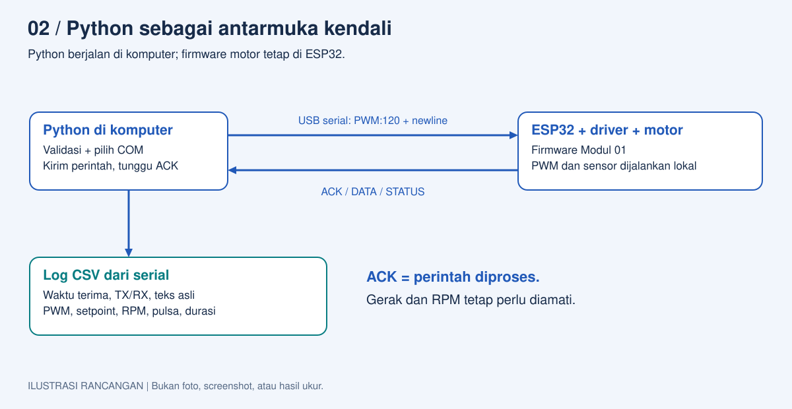
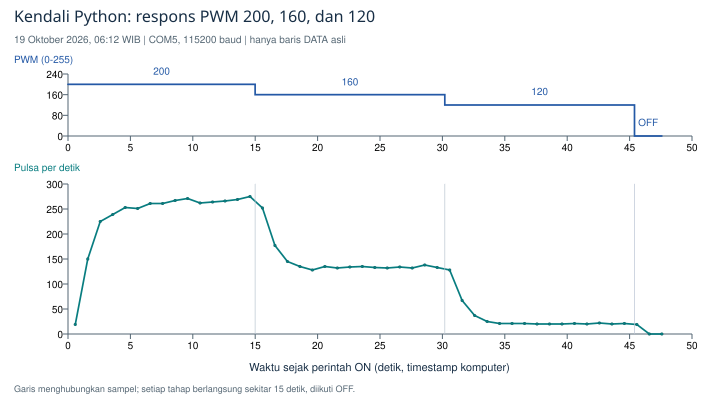
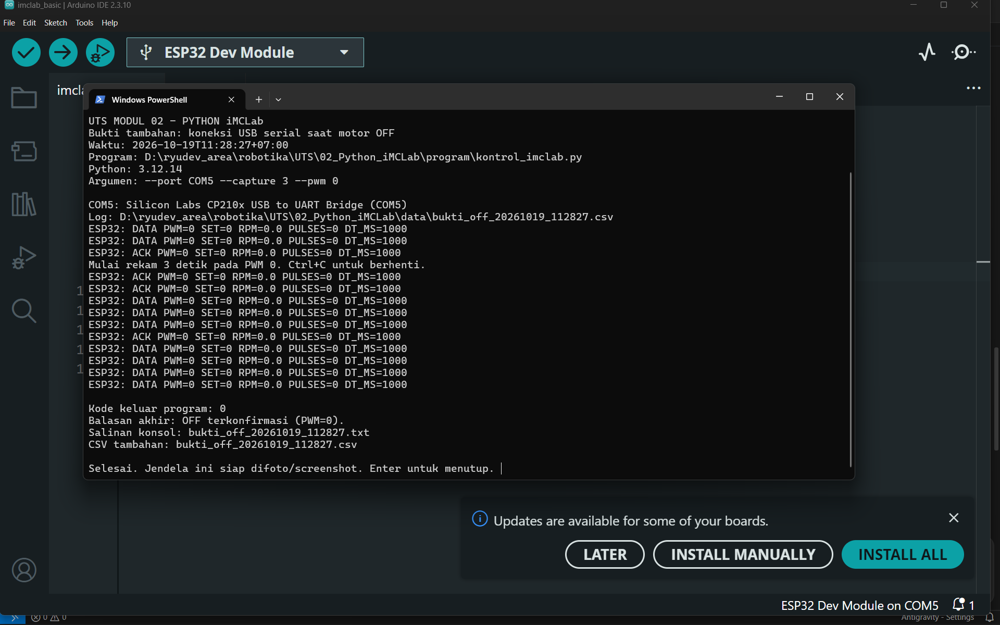
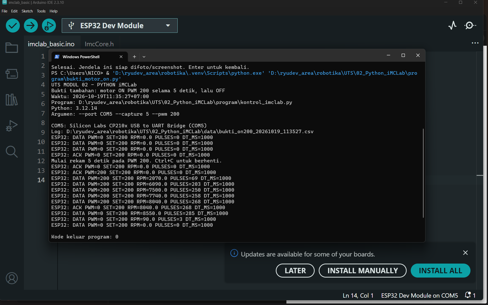
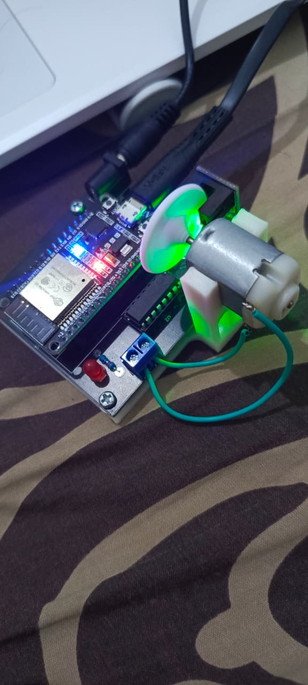

# Modul 02 - Kendali iMCLab Menggunakan Python

Identitas: [identitas mahasiswa](../IDENTITAS.md). Tanggal eksperimen: **19 Oktober 2026**.

Status laporan: **Koneksi Python, ON/OFF, variasi PWM, dan CSV sudah diuji pada kit. Identitas mahasiswa lengkap; RPM memakai asumsi PPR=2 yang belum dikalibrasi.**

## Ringkasan riset

Eksperimen menguji Python pada komputer sebagai pengirim perintah dan pencatat data iMCLab melalui USB serial. ESP32 tetap menjalankan firmware basic dari Modul 01. Empat sesi pada 19 Oktober 2026 pukul 06:10-06:14 WIB menghasilkan empat CSV asli dengan 67 baris DATA. Uji singkat PWM 200 berhasil menggerakkan motor tanpa bantuan tangan. Rangkaian berikutnya menyelesaikan PWM 200, 160, dan 120, masing-masing sekitar 15 detik, lalu menerima konfirmasi OFF.

Lima sampel akhir tiap fase memberikan laju rata-rata 267,2; 133,8; dan 20,8 pulsa/detik. Dua fase pertama memenuhi kriteria kestabilan deskriptif; fase 120 tetap berputar tetapi tidak memenuhi batas rentang relatif 5%. Operator mengonfirmasi putaran pelan pada tahap terakhir dan penghentian setelah tes. Hasil PWM 120 berbeda dari sesi Modul 01 yang turun sampai berhenti; penyebab perbedaannya belum diisolasi.

## Tujuan dan pertanyaan penelitian

Tujuan eksperimen adalah mengirim perintah yang valid dari Python, menerima balasan ESP32, dan menghasilkan rekaman yang dapat ditelusuri. Pertanyaan penelitian: apakah antarmuka Python dapat mengendalikan motor melalui firmware yang sama dan menghasilkan pola respons PWM yang sebanding dengan Modul 01?

Hipotesis awal: dengan firmware, catu, dan beban yang sama, perubahan antarmuka pengirim tetap menghasilkan kecenderungan respons motor yang sama. Kesamaan angka putaran tidak diasumsikan sebelum data dianalisis.

## Dasar teori dan materi dosen

Python berjalan di komputer, sedangkan PWM dan interupsi sensor berjalan pada ESP32. Percobaan menggunakan CP210x pada COM5, baud 115200, dan perintah berakhiran newline. Paket pySerial menyediakan pembukaan port, pengiriman byte, serta pembacaan baris dengan timeout. Pemilihan port otomatis hanya diterima jika ada satu kandidat USB-UART yang dikenali.

Notebook `Test_Port_Serial.ipynb` dan `Tes_IMCLab_pilih_port_otomatis.ipynb` menjadi dasar komunikasi dan pemilihan port. `Tes_IMCLab_naik_turun.ipynb` menjadi dasar pengubahan PWM. Paket UTS mengembangkan validasi input, konfirmasi perintah, pencatatan CSV, serta OFF saat sesi berakhir. Materi iTCLab dalam buku Jilid 1 dipakai untuk konsep Arduino-Python; pemetaan pin suhu tidak digunakan pada kit motor.

<!-- pagebreak -->

## Rancangan dan metode eksperimen



**Gambar 1.** Pembagian kerja komputer dan ESP32. Gambar merupakan ilustrasi rancangan, bukan screenshot pengujian. Setpoint dikirim lewat USB; CSV menyimpan TX, RX, serta peristiwa dari program. ACK menyatakan pemrosesan perintah, sehingga gerak motor tetap dikonfirmasi operator.

| Komponen | Konfigurasi saat uji |
| --- | --- |
| Kit dan firmware | iMCLab ESP32; imclab_basic 1.0.0 dari Modul 01 |
| Catu dan sambungan | Adaptor bawaan 5 V 2 A menurut label/operator; USB COM5 |
| Program komputer | Python 3.12.14; pySerial 3.5; Windows; virtual environment .venv |
| PWM dan sensor | 30 kHz, 8 bit; GPIO PWM 12, IN1 27, IN2 26, sensor 13 |
| Perhitungan putaran | Jendela sekitar 1 detik; asumsi 2 pulsa/putaran, belum dikalibrasi |

1. Operator memastikan USB, adaptor, meja, serta piringan siap. Serial Monitor Arduino ditutup untuk melepas COM5.
2. Python menampilkan port dan merekam tiga detik pada PWM 0. Uji singkat PWM 200 sekitar dua detik dilakukan setelah koneksi terkonfirmasi.
3. Setelah konfirmasi start tanpa bantuan, program ditambah pemeriksaan balasan dan penghentian bila DATA/pulsa hilang selama tiga detik pada mode capture.
4. Rangkaian utama menurunkan PWM 200 ke 160 lalu 120 tanpa berhenti di antara fase. Tiap fase sekitar 15 detik; setelah OFF, tiga detik telemetri tambahan dibaca.
5. Uji interaktif melalui stdin memeriksa R, PWM, +/-, input salah, dan port otomatis saat motor OFF. Setiap skenario dilakukan satu kali; lima sampel akhir bukan lima pengulangan eksperimen.

Program: [kontrol_imclab.py](program/kontrol_imclab.py). Langkah pengulangan: [panduan Modul 02](PANDUAN_UJI.md).

<!-- pagebreak -->

## Hasil variasi PWM



**Gambar 2.** Respons sesi `python_sweep_20261019_061241.csv`. Grafik atas menunjukkan PWM; grafik bawah menghubungkan sampel laju pulsa. Sesi memiliki 45 DATA aktif dan 6 DATA saat OFF. Sampel pertama setelah OFF masih berisi 19 pulsa, lalu dua sampel nol; sampel transisi tidak dipakai untuk rata-rata fase.

| PWM | Rata-rata pulsa/detik | Rentang pulsa/detik | RPM estimasi, PPR=2 | Kriteria stabil |
| --- | --- | --- | --- | --- |
| 200 | 267,2 | 262-275 | 8016 | Memenuhi |
| 160 | 133,8 | 132-138 | 4014 | Memenuhi |
| 120 | 20,8 | 20-22 | 624 | Tidak memenuhi |

Tiap baris menggunakan lima DATA terakhir yang seluruh jendela pengukurannya berada setelah lima detik awal fase. Kriteria deskriptif yang sama dengan Modul 01: fase selesai, lima sampel positif, dan `(maksimum-minimum)/rata-rata <= 5%`. Rentang relatif adalah 4,87%; 4,48%; dan 9,62%. Angka 20,8 pada PWM 120 merupakan rata-rata akhir pengamatan, bukan pernyataan bahwa kondisi sudah stabil.

Laju pulsa dihitung sebagai `PULSES * 1000 / DT_MS`. RPM estimasi adalah laju pulsa dikalikan 30, sesuai asumsi PPR=2. Seluruh DATA yang tercatat memiliki DT_MS=1000. RPM belum merupakan hasil kalibrasi putaran poros yang dapat dijadikan acuan absolut.

Operator mengonfirmasi pilot berputar sendiri lalu berhenti. Pada rangkaian utama, operator mengonfirmasi tahap akhir tetap berputar pelan lalu berhenti tanpa bantuan tangan. Selisih TX ON sampai TX OFF pada komputer adalah 45,392 detik; ini bukan pengukuran langsung lama gerak mekanis.

<!-- pagebreak -->

## Bukti komunikasi dan kualitas data

Empat log asli disimpan tanpa mengubah angka. Sesi OFF awal berisi 5 DATA, pilot berisi 5 DATA, variasi berisi 51 DATA, dan uji perintah OFF berisi 6 DATA: total 67 DATA. ACK/STATUS tidak dihitung sebagai sampel baru karena mengulang pengukuran terakhir. Grafik dan ringkasan dibuat oleh `UTS/tools/analisis_python.py`.

Cuplikan berikut berasal dari log rangkaian utama; beberapa baris di antaranya tidak ditampilkan. Ini transkripsi CSV asli, bukan screenshot terminal.

```text
TX PWM:200
RX ACK PWM=0 SET=200 RPM=0.0 PULSES=0 DT_MS=1000
TX 1
RX ACK PWM=200 SET=200 RPM=0.0 PULSES=0 DT_MS=1000
RX DATA PWM=200 SET=200 RPM=8250.0 PULSES=275 DT_MS=1000
RX DATA PWM=160 SET=160 RPM=3990.0 PULSES=133 DT_MS=1000
RX DATA PWM=120 SET=120 RPM=630.0 PULSES=21 DT_MS=1000
TX 0
RX ACK PWM=0 SET=120 RPM=630.0 PULSES=21 DT_MS=1000
RX DATA PWM=0 SET=120 RPM=0.0 PULSES=0 DT_MS=1000
```

Setpoint 200 saat OFF menghasilkan PWM aktual 0. Perintah 1 kemudian menghasilkan PWM 200. Setelah perintah 0, PWM dilaporkan 0 meskipun RPM pada ACK masih merupakan pengukuran sebelumnya; kondisi akhir diperiksa melalui DATA berikutnya dan pengamatan operator.

Uji saat OFF berhasil mengubah target 200 ke 190 dengan `-`, kembali ke 200 dengan `+`, menerima 255 dan 0, lalu mengembalikan target ke 200. Input `p256` dan `ON` ditolak Python dan tidak muncul sebagai TX pada CSV. Port otomatis berhasil dipilih ketika COM5 merupakan satu-satunya kandidat yang dikenali.

Sembilan tes software dengan port tiruan lulus pada Python 3.12.14: input tidak valid, port ambigu, balasan tidak sesuai, timeout, serta penghentian capture saat DATA/pulsa hilang. Rangkaian fisik tidak memicu penghentian dini; perilaku itu baru diverifikasi pada port tiruan dalam Modul 02.

Dua DATA sesi OFF awal masing-masing mencatat satu pulsa meskipun PWM=0. Data dipertahankan; penyebabnya belum diketahui dan bukan bukti bahwa motor digerakkan program. Pemeriksaan sensor dan pengukuran tambahan diperlukan untuk membedakan gerakan kecil, gangguan, atau penyebab lainnya.

<!-- pagebreak -->

## Perbandingan dengan Modul 01

| PWM | Modul 01, pulsa/detik | Modul 02, pulsa/detik | Selisih terhadap Modul 01 |
| --- | --- | --- | --- |
| 200 | 278,8 | 267,2 | -4,16% |
| 160 | 131,8 | 133,8 | +1,52% |
| 120 | Turun sampai nol; dihentikan dini | Tetap berputar; rata-rata akhir 20,8 | Tidak dibandingkan sebagai rata-rata stabil |

Pola utama sesuai hipotesis: PWM lebih rendah menghasilkan laju pulsa lebih rendah pada rangkaian ini. Namun, waktu pengujian dan kondisi mekanis/kelistrikan belum dikontrol ketat. Selisih pada PWM 200 dan 160 tidak membuktikan Python mengubah karakteristik motor; pembangkitan PWM tetap dilakukan firmware ESP32 yang sama.

Putaran yang bertahan pada PWM 120 kali ini menunjukkan hasil sebelumnya tidak dapat dijadikan ambang motor yang pasti. Karena tahap 120 dimulai saat motor sudah berputar, eksperimen ini tidak membuktikan motor dapat mulai dari diam pada PWM 120. Tidak dilakukan bantuan tangan pada sesi yang dikonfirmasi operator.

## Batas pengujian dan simpulan

Koneksi Python, ON/OFF, perubahan PWM, deteksi port, dan perekaman CSV berhasil diuji pada kit. Dua fase atas memenuhi kriteria kestabilan deskriptif; fase 120 tetap berputar dengan variasi relatif lebih besar. Data perintah, sensor, dan pengamatan operator mendukung keberhasilan kendali Python pada sesi ini.

Belum dilakukan replikasi independen yang memadai, kalibrasi PPR, pengukuran tegangan berbeban, latensi menyeluruh, atau uji kabel terputus. Timer Python memakai waktu monotonic, sedangkan CSV memakai jam kalender; selisih TX bukan ukuran ketepatan timer maupun latensi penuh.

Guard kehilangan pulsa hanya aktif saat capture dan bergantung pada sensor serta proses Python yang tetap berjalan. Mode interaktif menunggu input dan dapat menumpuk DATA. Blok finally mencoba mengirim OFF; firmware basic belum mempunyai watchdog komunikasi, sehingga koneksi terputus atau proses dihentikan paksa tetap memerlukan pemutusan catu motor oleh operator.

## Kelengkapan bukti

Log mentah, keluaran konsol teks, catatan operator, grafik, screenshot terminal Python saat OFF dan ON, serta foto susunan kit tersedia. Screenshot dan foto dikirim operator pada 19 Oktober 2026 dan disertakan pada halaman dokumentasi berikut. Empat sesi utama dengan 67 DATA tetap menjadi sumber grafik; pemeriksaan dokumentasi tambahan dicatat terpisah.

- [Indeks log asli](data/ringkasan_log.md) dan [ringkasan analisis](data/hasil_analisis.json).
- [Catatan pengamatan](data/pengamatan.md) dan [asal-usul bukti](bukti/README.md).

<!-- pagebreak -->

## Dokumentasi terminal Python saat OFF



**Gambar 3.** Screenshot asli dari operator pada pemeriksaan 19 Oktober 2026 pukul 11:28 WIB. Terlihat jalur `kontrol_imclab.py` dalam folder Modul 02, Python 3.12.14, COM5 CP210x, argumen capture tiga detik pada PWM 0, respons serial, dan kode keluar 0. Arduino IDE di belakang terminal tetap membuka firmware basic yang digunakan ESP32.

Pemeriksaan ini menjalankan program dengan motor OFF. Nilai PWM=0 dan RPM=0 sesuai skenario tersebut. Gambar mendokumentasikan komunikasi Python dan kondisi keluaran OFF. Dokumentasi tambahan saat ON disajikan pada halaman berikut.

CSV yang sesuai dengan screenshot adalah `bukti_off_20261019_112827.csv`. Pemeriksaan ini dicatat setelah eksperimen utama, sehingga datanya tidak ditambahkan ke rata-rata fase PWM 200, 160, dan 120. Screenshot dipertahankan tanpa mengubah angka, teks, atau tampilan aplikasi.

<!-- pagebreak -->

## Dokumentasi terminal Python saat ON



**Gambar 4.** Screenshot asli pengulangan dokumentasi pada 19 Oktober 2026 pukul 11:35 WIB. Terminal menampilkan program Python Modul 02, COM5, argumen capture lima detik pada PWM 200, lima DATA aktif dengan pulsa positif, respons OFF, DATA terakhir nol, dan kode keluar 0. Firmware yang tampak di belakang terminal adalah imclab_basic.ino.

Sumber sesi adalah `bukti_on200_20261019_113527.csv` dan konsol teks dengan nama yang sama. Log memuat 11 DATA: tiga sebelum ON, lima pada PWM 200, dan tiga setelah OFF. Lima sampel aktif mencatat 69, 203, 250, 258, dan 268 pulsa per jendela 1000 ms; estimasi RPM berturut-turut 2070, 6090, 7500, 7740, dan 8040 dengan asumsi PPR=2. Selisih TX ON sampai TX OFF adalah 5,198 detik berdasarkan waktu komputer.

ACK setelah OFF melaporkan PWM=0 tetapi mengulang pengukuran terakhir, yaitu 8040 RPM. Tiga DATA berikutnya berisi 285, 3, dan 0 pulsa. Pembacaan saat peralihan dapat mencakup bagian jendela sebelum OFF dan gerak sisa setelah daya motor dihentikan; angka itu bukan pengukuran kecepatan seketika saat perintah diterima. Kondisi akhir telemetri adalah PWM=0 dan RPM=0.

Uji lima detik ini melengkapi bukti komunikasi dan respons sensor; datanya tidak dimasukkan ke analisis kestabilan rangkaian utama. Percobaan sebelumnya pada 11:33 WIB gagal membuka COM5 dengan pesan Access is denied. Log gagal dipertahankan dan tidak memuat TX maupun RX, sehingga tidak dihitung sebagai uji motor.

<!-- pagebreak -->

## Dokumentasi susunan kit



**Gambar 5.** Foto asli yang dikirim operator pada 19 Oktober 2026. Tampak modul ESP32 pada papan iMCLab, sambungan USB, motor DC, piringan encoder, sensor optik, serta kabel motor pada terminal sekrup. Gambar dipakai untuk mendokumentasikan perangkat dan sambungan fisik.

Foto tunggal tidak dipakai untuk mengukur kecepatan atau menentukan status ON/OFF. Angka PWM dan RPM dirujuk ke log serial, sedangkan gerak mekanis pada pengujian utama dikonfirmasi melalui pengamatan operator. Identitas tetap kosong sesuai permintaan, dan PPR masih memerlukan kalibrasi.

## Rujukan

Rahmat, B., dan Muljono. (2024). Pemrograman Internet of Things (IoT) dengan Arduino dan Python, Jilid 1, bagian Arduino-Python. Tiga notebook Python dari materi kelas. [Dokumentasi pySerial](https://pyserial.readthedocs.io/en/latest/pyserial_api.html), diakses 19 Oktober 2026. [Peta referensi](../REFERENSI.md).
