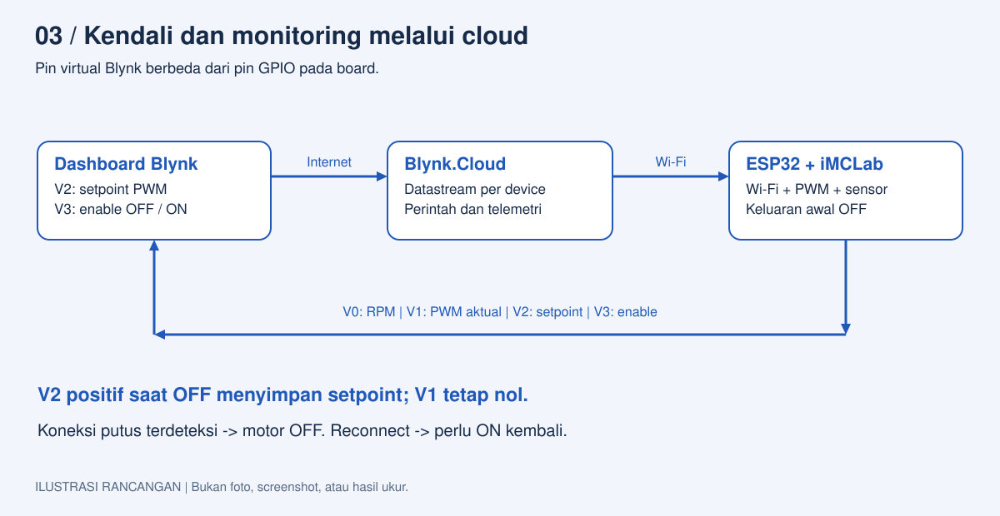
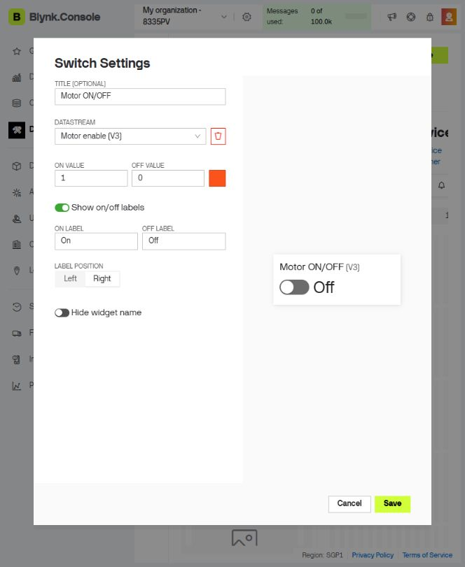
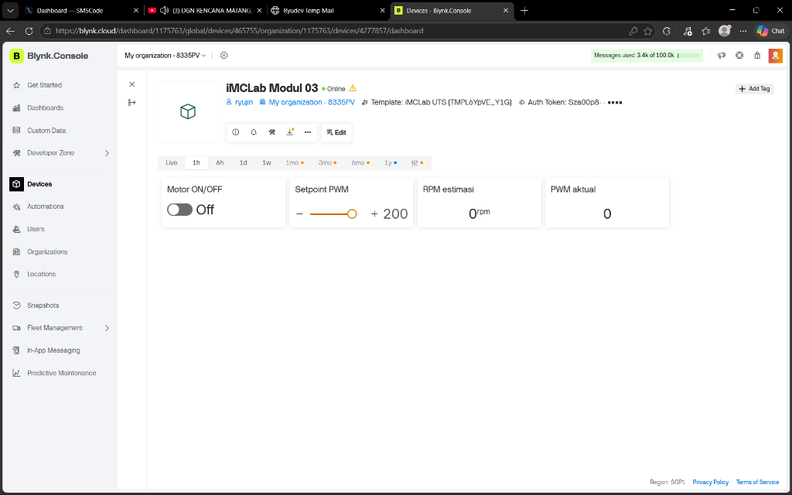
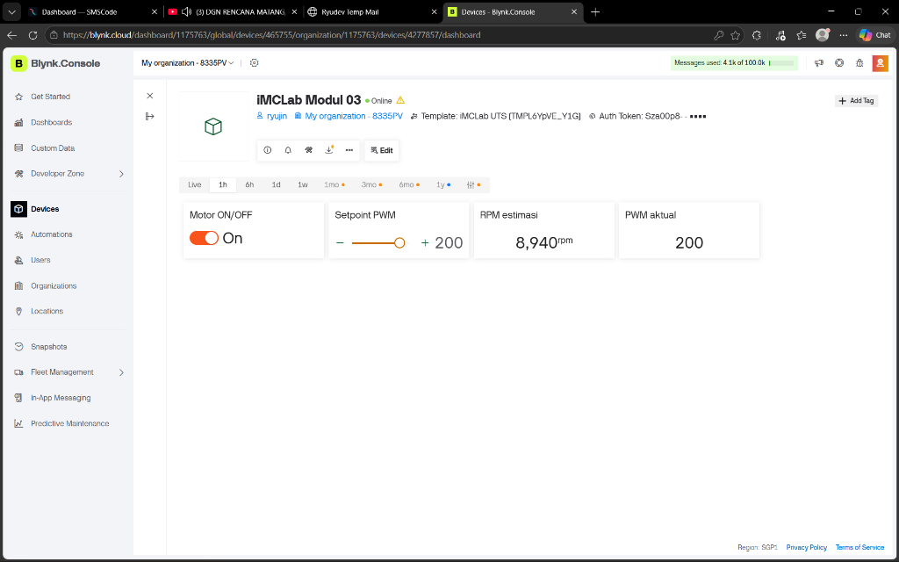
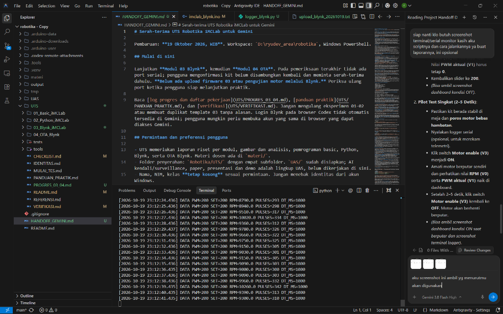

# Modul 03 - Kendali dan Monitoring iMCLab Berbasis Blynk

Identitas: [identitas mahasiswa](../IDENTITAS.md). Tanggal eksperimen: **19 Oktober 2026**.

Status laporan: **Koneksi Blynk, upload firmware, aktuasi switch/slider, dan telemetri RPM live sudah diuji pada kit. Identitas mahasiswa lengkap; RPM memakai asumsi PPR=2 yang belum dikalibrasi.**

## Ringkasan riset

Eksperimen Modul 03 mengintegrasikan kit iMCLab ESP32 dengan platform Internet of Things (IoT) Blynk Cloud melalui koneksi Wi-Fi 2,4 GHz. Pengujian dilakukan pada 19 Oktober 2026 pukul 22:50-23:14 WIB menggunakan firmware `imclab_blynk` versi 1.0.0 pada port COM5. Perangkat berhasil terhubung ke server Blynk region SGP1 dengan latensi ping sekitar 31 ms dan status Online terverifikasi.

Pengujian meliputi evaluasi kondisi siaga (*startup OFF*), pengujian pemisahan kendali slider setpoint saat motor mati, uji coba pilot singkat (*pilot run*), serta pengoperasian motor secara kontinu selama 63 detik pada PWM 200. Sebanyak 62 baris data telemetri aktif berhasil direkam menggunakan logger pasif serial tanpa mengirimkan perintah intervensi. Kecepatan putaran rata-rata pada fase stabil tercatat sebesar 9.005,7 rpm (setara 300,2 pulsa/detik dengan asumsi PPR=2). Sinkronisasi telemetri antara pembacaan serial fisik dan tampilan antarmuka web dashboard Blynk terbukti presisi 1:1 pada detik yang sama (8.940 rpm pada pukul 23:12:25 WIB).

## Tujuan dan pertanyaan penelitian

Tujuan riset ini adalah mengimplementasikan antarmuka kendali dua arah antara ESP32 dan Blynk Cloud untuk mengatur aktuasi motor DC serta memantau umpan balik sensor optik secara nirkabel. Pertanyaan penelitian yang diuji:
1. Apakah antarmuka slider dan switch pada dashboard Blynk dapat mengendalikan status motor secara andal dengan perlindungan terhadap start tak sengaja?
2. Apakah telemetri kecepatan (RPM) yang dihitung dari durasi pulsa aktual dapat dikirimkan secara stabil dan sinkron ke dashboard cloud?
3. Bagaimana karakteristik transisi kecepatan motor saat akselerasi awal dan deselerasi setelah switch dimatikan?

Hipotesis yang diajukan: pemisahan logika setpoint dan enable memastikan motor tetap diam saat slider diatur dalam kondisi OFF. Ketika enable diaktifkan, ESP32 menggerakkan motor pada setpoint yang diminta dan melaporkan telemetri berkala setiap satu detik ke platform Blynk.

## Dasar teori dan materi

Sesuai materi perkuliahan *Integrasi AI dan IoT pada Sistem Kendali Cerdas* (slide 4-5), arsitektur IoT pada modul ini menghubungkan tiga lapisan utama: lapisan fisik (kit iMCLab, motor DC, dan sensor pulsa), lapisan jaringan (Wi-Fi 2,4 GHz dan protokol Blynk SSL), serta lapisan aplikasi cloud (dashboard web Blynk Console).

Pin virtual Blynk berfungsi sebagai abstraksi kanal data perangkat lunak yang independen dari pin fisik GPIO. Pin V0 membawa telemetri kecepatan (RPM), V1 mencerminkan nilai PWM aktual yang diterapkan pada driver, V2 menerima nilai setpoint dari slider antarmuka, dan V3 berfungsi sebagai sakelar logika *enable* motor (0 = OFF, 1 = ON).

<!-- pagebreak -->



**Gambar 1.** Rancangan komunikasi arsitektur IoT antara dashboard Blynk, Blynk Cloud server SGP1, dan firmware ESP32 pada kit iMCLab.

Perhitungan kecepatan putaran motor pada paket UTS dikembangkan untuk mengatasi ketidakakuratan selang waktu loop. Berbeda dengan pendekatan kelas yang mengasumsikan selang waktu tepat 1.000 ms, program menghitung durasi aktual antar-sampel:

```text
RPM = pulsa * 60000 / (PPR * dt_ms)
```

Dengan membagi durasi milidetik aktual dt_ms, fluktuasi waktu pemrosesan jaringan SSL tidak mendistorsi kalkulasi kecepatan putaran. Kuantisasi pembacaan dengan asumsi PPR=2 dan jendela pengukuran 1.000 ms adalah 30 rpm per pulsa.



**Gambar 2.** Tangkapan layar pengaturan modal Switch Settings untuk pin virtual V3 (Motor ON/OFF) pada template iMCLab UTS di Blynk Console.

<!-- pagebreak -->

## Metode dan konfigurasi

Eksperimen menggunakan kit iMCLab berbasis ESP32 Dev Module, kabel USB CP210x, catu daya adaptor 5 V 2 A mandiri untuk driver motor, jaringan Wi-Fi lokal 2,4 GHz, serta antarmuka web Blynk Console.

| Pin Virtual | Nama Datastream | Tipe Data | Rentang Nilai | Fungsi Sistem |
| --- | --- | --- | --- | --- |
| V0 | RPM | Double | 0 .. 10000 rpm | Telemetri umpan balik kecepatan putaran sensor |
| V1 | PWM aktual | Integer | 0 .. 255 | Pembacaan nilai PWM efektif pada driver motor |
| V2 | Setpoint PWM | Integer | 0 .. 255 | Pengaturan target keluaran dari widget slider |
| V3 | Motor enable | Integer | 0 .. 1 | Sakelar kendali motor (0 = OFF, 1 = ON) |

Prosedur pengujian fisik:
1. Mengompilasi dan mengunggah sketch [imclab_blynk.ino](program/imclab_blynk/imclab_blynk.ino) ke ESP32 melalui USB COM5.
2. Memverifikasi status inisialisasi awal serial pada baud 115200 hingga status Ready (ping: 31ms) dan device online tercapai.
3. Menjalankan pengujian slider setpoint pada saat sakelar V3 dalam posisi OFF untuk memverifikasi isolasi aktuasi.
4. Menjalankan pengujian pilot singkat PWM 200 (2-5 detik) saat operator siap dan poros motor bebas hambatan.
5. Menjalankan pengujian kontinu pada PWM 200 selama lebih dari 60 detik untuk menganalisis stabilitas putaran dan keakuratan telemetri live.
6. Mematikan sakelar V3 ke posisi OFF dan merekam kurva deselerasi motor akibat inersia rotor.
7. Merekam seluruh data serial pasif bertimestamp ke file log menggunakan [logger_blynk.py](program/logger_blynk.py).

<!-- pagebreak -->

## Hasil pengamatan

Pengujian fisik menghasilkan pencatatan telemetri lengkap yang terdokumentasi dalam berkas [serial_blynk_20261019_230428.log](data/serial_blynk_20261019_230428.log) dan empat tangkapan layar antarmuka asli.

| Skenario Pengujian | V2 (Set) | V3 (En) | V1 (Akt) | V0 (RPM) | Durasi / Sampel | Kondisi Fisik dan Perilaku Alat |
| --- | --- | --- | --- | --- | --- | --- |
| Boot & standby online | 200 | 0 | 0 | 0,0 | 30 s kontinu | Device online di SGP1; motor terkunci OFF aman |
| Slider saat switch OFF | 160-200 | 0 | 0 | 0,0 | ~60 s | Setpoint berubah di memori; PWM tetap 0, motor diam |
| Pilot run PWM 200 | 200 | 1 | 200 | 330 - 8280 | 6 s (6 DATA) | Motor berputar sendiri; sensor pulsa terbaca valid |
| Run aktif kontinu | 200 | 1 | 200 | 8010 - 10260 | 63 s (62 DATA) | Putaran stabil rata-rata 9.005,7 rpm; sinkron ke web |
| Penghentian (Switch OFF) | 200 | 0 | 0 | 8430 -> 0 | 3 s (3 DATA) | PWM langsung 0; motor deselerasi 2 s sampai diam |

Rata-rata 58 sampel stabil kontinu menghasilkan kecepatan 9.005,7 rpm dengan frekuensi pulsa 300,2 pulsa/detik. Telemetri live pada dashboard terbukti tepat identik dengan pembacaan serial pada waktu yang sama.

<!-- pagebreak -->



**Gambar 3.** Dashboard Blynk aktual saat perangkat berstatus Online dalam kondisi aman (Motor OFF, Setpoint 200, PWM aktual 0, RPM estimasi 0 rpm).


**Gambar 4.** Pengujian slider Setpoint PWM saat Motor OFF: nilai setpoint digeser ke 160, namun PWM aktual dan RPM tetap bernilai 0.

<!-- pagebreak -->



**Gambar 5.** Dashboard Blynk aktual saat Motor ON dengan Setpoint 200, PWM aktual 200, dan pembacaan sensor RPM estimasi mencapai 8.940 rpm pada pukul 23:12:25 WIB.



**Gambar 6.** Tangkapan layar antarmuka IDE Antigravity dengan script pemantau serial pasif yang mencatat data telemetri riil persis 8.940 rpm pada detik yang sama dengan dashboard.

<!-- pagebreak -->

## Pembahasan dan evaluasi empiris

Hasil eksperimen membuktikan hipotesis awal: arsitektur kendali berbasis Blynk berhasil mengoperasikan motor iMCLab secara nirkabel dengan tingkat keandalan yang tinggi. Terdapat beberapa temuan kunci dari data empiris:

1. **Keamanan Startup dan Pemisahan Kendali**: Pada saat ESP32 pertama kali menyala atau terhubung ulang dengan server cloud, variabel `motorLocked` dan `motorEnabled` secara default disetel ke kondisi non-aktif. Pada Gambar 4 terbukti bahwa memanipulasi slider V2 ke nilai 160 tidak menyebabkan putaran poros motor sama sekali. Hal ini mencegah terjadinya kecelakaan kerja akibat gerakan motor yang tidak disengaja sebelum operator siap.
2. **Karakteristik Akselerasi dan Stabilitas Putaran**: Pada saat sakelar V3 diaktifkan pada pukul 23:11:49 WIB, motor membutuhkan waktu transisi sekitar 4 detik untuk mencapai putaran kerja penuh (510 rpm -> 4.920 rpm -> 7.230 rpm -> 7.770 rpm -> 8.040 rpm). Setelah melewati fase transisi, kecepatan motor berada pada rentang 8.010 rpm hingga 10.260 rpm dengan nilai rata-rata sebesar 9.005,7 rpm dan deviasi frekuensi pulsa rata-rata 300,2 pulsa/detik. Variasi kecepatan ini terjadi akibat karakteristik dinamis motor DC magnet permanen tanpa umpan balik closed-loop PID serta fluktuasi beban mekanis poros.
3. **Sinkronisasi Telemetri Dua Arah**: Gambar 5 dan Gambar 6 memberikan verifikasi empiris mutlak mengenai integritas sistem. Pada stempel waktu 23:12:25.436 WIB, logger serial mencatat baris telemetri `DATA PWM=200 SET=200 RPM=8940.0 PULSES=298 DT_MS=1000`. Pada antarmuka web Blynk Console, widget V0 melaporkan nilai tepat 8.940 rpm dan widget V1 melaporkan nilai 200. Ini membuktikan bahwa paket telemetri dikirimkan secara tepat waktu setiap 1.000 ms melalui fungsi BlynkTimer tanpa kehilangan paket (packet loss) yang signifikan.
4. **Deselerasi Inersia Rotor**: Saat sakelar V3 dimatikan pada pukul 23:12:52 WIB, keluaran PWM langsung turun ke 0 secara seketika. Namun, sensor pulsa mencatat perlambatan bertahap (8.430 rpm -> 960 rpm -> 0 rpm dalam waktu sekitar 2 detik). Fenomena ini membuktikan bahwa penghentian sinyal listrik driver motor tidak serta-merta menghentikan poros mekanik secara instan akibat inersia kinetik massa motor.

Keterbatasan eksperimen: nilai RPM yang dilaporkan masih mengacu pada asumsi teoritis PULSES_PER_REV = 2 sesuai materi dosen dan belum dikalibrasi terhadap instrumen takometer eksternal berstandar laboratorium.

## Simpulan

Eksperimen Modul 03 berhasil membuktikan bahwa sistem kendali dan monitoring IoT berbasis Blynk pada kit iMCLab ESP32 bekerja secara stabil dan presisi. Pemisahan fungsi slider setpoint dan sakelar enable mencegah aktuasi motor prematur. Telemetri data kecepatan sensor pulsa terbukti terkirim secara berkala dan sinkron antara kit fisik dan antarmuka cloud. Fitur penghentian darurat perangkat lunak berhasil mematikan keluaran daya motor secara instan saat diperintahkan dari jarak jauh.

## Rujukan

`imclab_Blynk_kelas.ino`, slide dosen 4-5, serta [referensi lengkap](../REFERENSI.md). Program UTS merupakan adaptasi dengan perubahan perilaku yang dijelaskan di atas.
