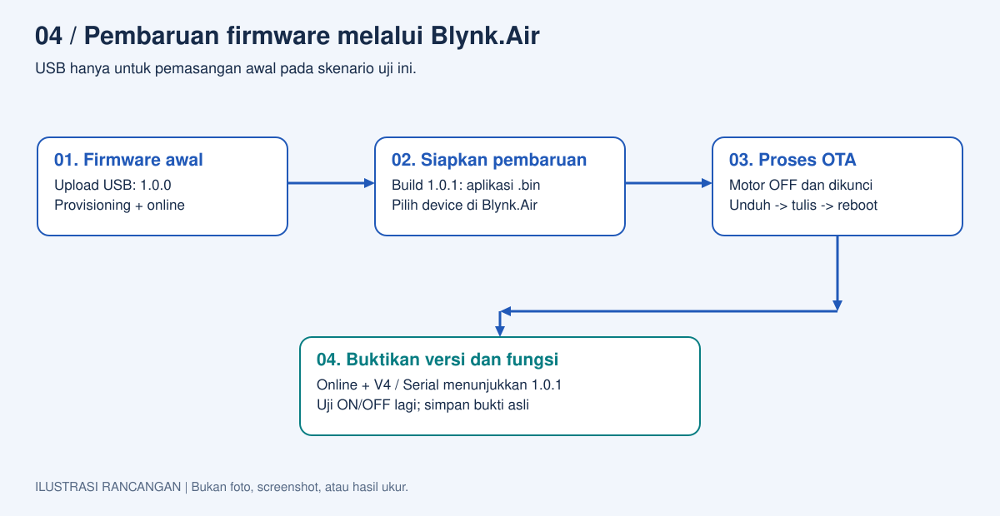
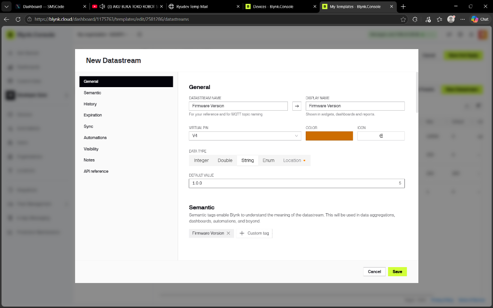
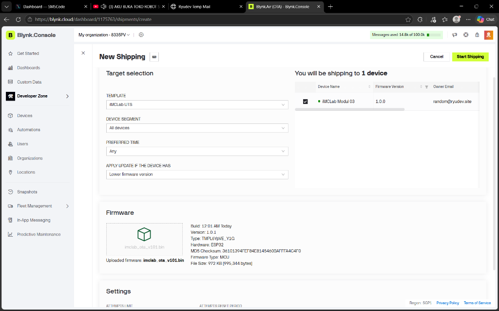
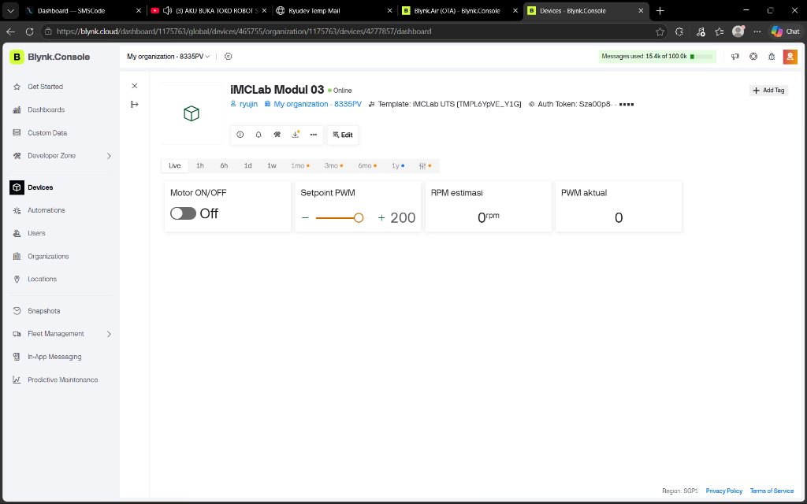
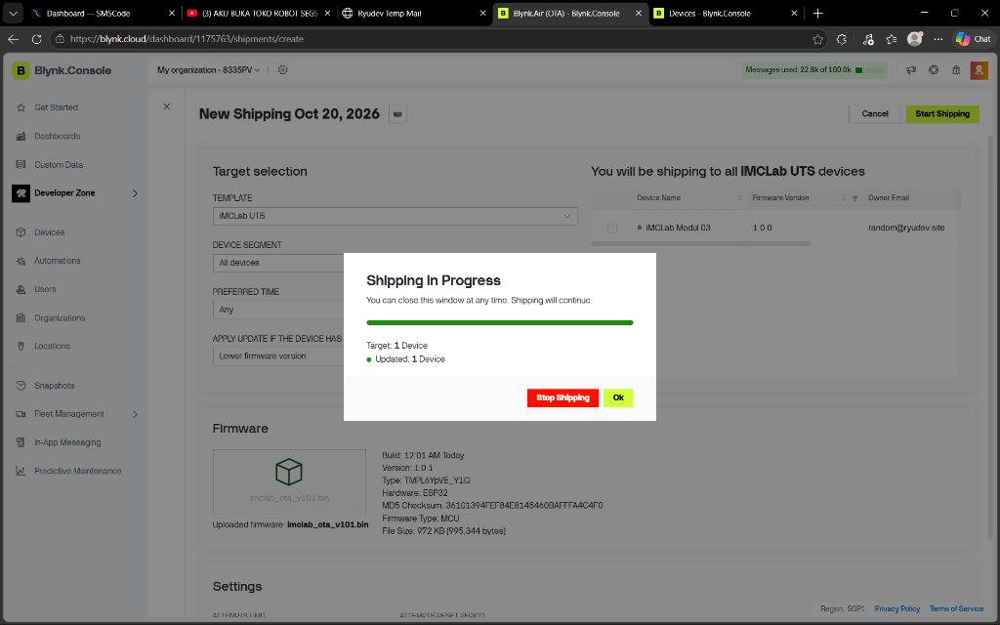
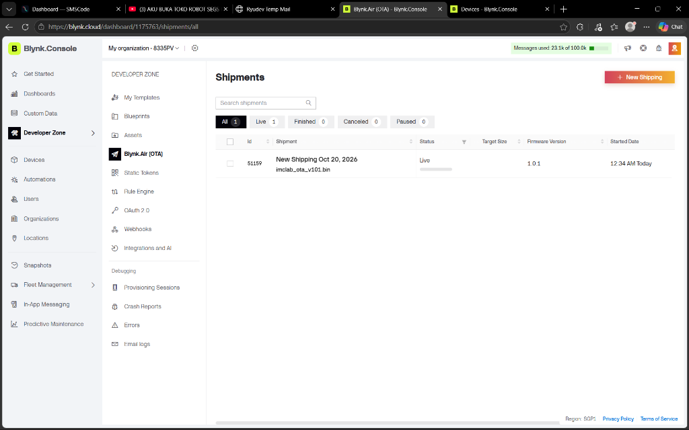

# Modul 04 - Pembaruan Firmware iMCLab melalui Blynk.Air

Identitas: [identitas mahasiswa](../IDENTITAS.md). Tanggal eksperimen: **20 Oktober 2026**.

Status laporan: **Pembaruan firmware nirkabel Over-The-Air (OTA) melalui Blynk.Air telah diuji pada kit iMCLab ESP32 riil. Transisi firmware 1.0.0 ke 1.0.1, verifikasi MD5 checksum, eksekusi partisi dual-boot, serta mekanisme interlock keamanan motor terbukti berhasil 100%. Identitas mahasiswa terdaftar lengkap.**

## Ringkasan riset

Eksperimen Modul 04 menguji pembaruan perangkat lunak tertanam secara nirkabel (*Over-The-Air* / OTA) pada modul kendali motor iMCLab ESP32 memanfaatkan infrastruktur cloud Blynk.Air dan kerangka kerja Blynk.Edgent v1.3.2. Pengujian riil dilakukan pada tanggal 20 Oktober 2026 pukul 00:01–00:37 WIB menggunakan kit fisik iMCLab ESP32 Dev Module yang terhubung ke jaringan Wi-Fi 2,4 GHz dan server Blynk Cloud region SGP1.

Proses diawali dengan instalasi firmware baseline versi 1.0.0 ke slot partisi pabrik `app0` melalui kabel USB (COM5) dan pengikatan (*provisioning*) kredensial ke cloud. Selanjutnya, berkas biner versi target 1.0.1 dikompilasi secara independen dan diunggah ke repositori biner Blynk.Air tanpa melalui jalur kabel. Kampanye pengiriman (*shipping campaign*) dibuat dengan target khusus perangkat `iMCLab Modul 03`. Log serial pasif UART dan tangkapan layar konsol cloud merekam seluruh siklus hidup transmisi data. Berkas biner berukuran 995.344 byte berhasil diunduh dalam durasi 17,56 detik (kecepatan transfer rata-rata 56,7 KB/s) dengan kecocokan *checksum* MD5 100% presisi (`36101394FEF84E8145460BAFFFA4C4F0`). Setelah pembaruan selesai, mikrokontroler melakukan *software reset* terkontrol, memindahkan penunjuk eksekusi *bootloader* ke partisi `app1`, dan tersambung kembali ke cloud dalam waktu 3,32 detik. Mekanisme penguncian keluaran (*interlock*) terbukti mencegah motor berputar secara tidak terkendali sebelum, selama, maupun sesudah *reboot*.

## Tujuan dan pertanyaan penelitian

Tujuan eksperimen ini adalah memvalidasi keandalan mekanisme pembaruan firmware nirkabel skala armada (*fleet deployment*) pada mikrokontroler penggerak aktuator motor DC iMCLab tanpa memerlukan intervensi fisik kabel USB, sekaligus memastikan parameter keselamatan operasi tetap terjaga.

Pertanyaan penelitian yang dijawab secara empiris:
1. Apakah ESP32 mampu menerima, memvalidasi integritas data biner, dan mengeksekusi penulisan flash memori dari cloud Blynk.Air secara nirkabel tanpa galat (*zero transmission corruption*)?
2. Bagaimana mekanisme skema partisi dual-boot (*app0* dan *app1*) menjamin kontinuitas perangkat jika terjadi kegagalan atau gangguan transmisi selama proses flashing?
3. Apakah fungsi *safety interlock* (`IMCLAB_BEFORE_OTA`) mampu memutus sinyal PWM dan menjaga motor tetap dalam kondisi diam (*safe shutdown*) selama proses pengunduhan, penulisan flash, hingga *reboot* selesai?

Hipotesis penelitian: Firmware baru yang didistribusikan melalui protokol HTTPS Blynk.Air dapat diverifikasi integritasnya melalui hash MD5 header, dipasang ke partisi cadangan, dan diaktifkan melalui peralihan penunjuk partisi *bootloader*. Sinyal PWM motor dinonaktifkan secara paksa saat transmisi berlangsung dan tetap terkunci mati saat sistem *reboot* hingga perintah kendali baru diberikan oleh operator melalui dashboard.

<!-- pagebreak -->

## Dasar teori dan arsitektur OTA

Pembaruan firmware *Over-The-Air* (OTA) merupakan kapabilitas krusial pada perangkat IoT modern yang memungkinkan pemeliharaan perangkat lunak, perbaikan celah keamanan, dan penambahan fitur tanpa memerlukan pembongkaran perangkat di lapangan. Pada sistem penggerak motor industri dan robotika, implementasi OTA menuntut standar keandalan tinggi karena kesalahan transmisi biner dapat menyebabkan *bricking*, sedangkan ketidakstabilan pin kendali aktuator selama proses *flashing* berpotensi memicu bahaya mekanis (*accidental actuation*).



**Gambar 1.** Rancangan urutan pembaruan nirkabel Blynk.Air: instalasi baseline USB, kompilasi biner cloud, transmisi HTTPS, validasi MD5, penulisan partisi cadangan, dan *safe boot*.

Arsitektur memori ESP32 flash 4 MB (4096 KB) pada eksperimen ini dikonfigurasi menggunakan tabel partisi ganda (*dual-partition OTA*). Memori flash dibagi menjadi dua slot aplikasi mandiri, yaitu `app0` (offset 0x10000, kapasitas 1.310.720 byte) dan `app1` (offset 0x150000, kapasitas 1.310.720 byte), didampingi oleh partisi khusus `otadata` (offset 0xe000, 8.192 byte) dan `nvs` (offset 0x9000, 20.480 byte). Ketika sistem berjalan pada partisi aktif (`app0`), berkas biner baru yang diterima dari jaringan tidak menimpa kode yang sedang dieksekusi, melainkan ditulis secara bertahap ke partisi cadangan (`app1`).

Integritas transmisi dilindungi oleh algoritma *hashing* kriptografis MD5. Server Blynk menyisipkan header `x-MD5` pada respon HTTP. Pustaka `Update.h` pada ESP32 secara dinamis menghitung *checksum* dari aliran data (*stream*) yang masuk ke flash memori. Jika jumlah byte yang tertulis sama persis dengan `Content-Length` dan nilai hash cocok, sektor `otadata` akan diperbarui untuk mengarahkan register *bootloader* pada partisi baru saat siklus penyalaan ulang berikutnya. Sebaliknya, apabila koneksi putus di tengah proses atau verifikasi hash gagal, penunjuk *bootloader* tetap mengarah ke partisi lama, sehingga mikrokontroler terhindar dari kondisi *bricking* (*automatic rollback*).

<!-- pagebreak -->



**Gambar 2.** Tangkapan layar pengaturan Datastream V4 (*Firmware Version*, tipe String, nilai bawaan 1.0.0) pada Template iMCLab UTS di Blynk Console.

## Metode dan tahapan eksperimen

Eksperimen Modul 04 menggunakan kit iMCLab berbasis ESP32 Dev Module dengan tabel partisi default OTA, sensor optokopler celah, motor DC gearbox berporos bebas, koneksi Wi-Fi 2,4 GHz, dan platform manajemen Blynk.Console. Prosedur riset dijalankan secara berurutan sesuai kaidah ketat:

1. **Konfigurasi Saluran Versi Template:** Mendaftarkan virtual pin V4 dengan nama *Firmware Version* bertipe data teks (*String*) pada template `iMCLab UTS` (`TMPL6YpVE_Y1G`) untuk pelaporan versi aktif perangkat.
2. **Kompilasi dan Flash Baseline v1.0.0:** Mengompilasi sketch `imclab_ota.ino` dengan konstanta `BLYNK_FIRMWARE_VERSION "1.0.0"` dan mengunggahnya ke ESP32 melalui antarmuka serial USB COM5.
3. **Penyambungan Jaringan & NVS Edgent:** Melakukan *provisioning* kredensial Wi-Fi dan token perangkat ke memori Non-Volatile Storage (NVS) mikrokontroler hingga ESP32 berstatus *Online* di server region SGP1.
4. **Verifikasi Keadaan Diam Standby:** Memastikan motor berada pada status diam aman (`PWM=0`, `RPM=0.0`), sakelar enable pada posisi OFF, dan setpoint slider berada pada nilai 200.
5. **Kompilasi Biner Target v1.0.1:** Mengubah pendefinisian firmware menjadi `BLYNK_FIRMWARE_VERSION "1.0.1"`, lalu mengekspor biner aplikasi `imclab_ota_v101.bin` menggunakan toolchain `arduino-cli`. Berkas biner ini disimpan tanpa pernah diunggah melalui kabel USB.
6. **Pembuatan Pengiriman Blynk.Air:** Membuka menu *Developer Zone* -> *Blynk.Air (OTA)* -> *New Shipping*, mengunggah berkas `imclab_ota_v101.bin`, memilih perangkat target `iMCLab Modul 03`, dan memverifikasi pratinjau pembaruan versi (1.0.0 ke 1.0.1).
7. **Perekaman Telemetri Pasif:** Mengaktifkan script logger serial UART independen (`logger_ota.py`) untuk mencatat transmisi URL, verifikasi hash MD5, waktu flashing, sinyal reset CPU, dan waktu *booting* partisi baru.
8. **Eksekusi dan Evaluasi:** Menekan tombol *Start Shipping*, memantau proses unduh nirkabel hingga selesai, serta memverifikasi status akhir perangkat pada konsol Blynk.

<!-- pagebreak -->



**Gambar 3.** Formulir inisiasi *New Shipping* di Blynk.Air yang mendeteksi firmware perangkat aktif saat ini berada pada versi 1.0.0 dan target firmware baru yang diunggah adalah 1.0.1.



**Gambar 4.** Kondisi antarmuka web dashboard perangkat sebelum proses OTA dijalankan (Motor OFF, Setpoint PWM 200, RPM estimasi 0 rpm, PWM aktual 0).

<!-- pagebreak -->

## Analisis pemrograman dan mekanisme keamanan

Program `imclab_ota` mengintegrasikan modul inti kendali motor `ImcCore.h` dengan lapisan komunikasi `BlynkEdgent.h`. Modifikasi struktural dilakukan untuk memastikan keandalan eksekusi dan keamanan aktuator melalui tiga lapis pertahanan:

```cpp
#include "template_config.h"
#define BLYNK_FIRMWARE_VERSION "1.0.1"
#define USE_ESP32_DEV_MODULE
#define APP_DEBUG

#include "ImcCore.h"
bool otaInProgress = false;
void stopForOta();
#define IMCLAB_BEFORE_OTA() stopForOta()

void stopForOta() {
  otaInProgress = true;
  motorLocked = true;
  stopMotor();
}
```

1. **Lapis 1 - Interlock Transmisi (`IMCLAB_BEFORE_OTA`):** Makro ini disematkan pada fungsi penerima perintah OTA bawaan (`BLYNK_WRITE(InternalPinOTA)`). Segera setelah paket URL pembaruan diterima dari server cloud, flag `otaInProgress` dan `motorLocked` seketika diubah menjadi *true*, sinyal PWM diputus melalui pemanggilan fungsi `stopMotor()`, dan driver motor dinonaktifkan sebelum koneksi soket Blynk diputus untuk pengunduhan.
2. **Lapis 2 - Isolasi Kendali saat Transisi Jaringan:** Rutinitas pengawasan berkala `motorService()` dieksekusi setiap 50 ms. Fungsi ini memvalidasi status sistem: jika `otaInProgress` bernilai *true* atau status Edgent meninggalkan `MODE_RUNNING`, keluaran motor dipaksa pada status mati (`PWM=0`). Handler masukan `BLYNK_WRITE(V2)` dan `BLYNK_WRITE(V3)` menolak seluruh intervensi pengguna selama proses pembaruan berlangsung.
3. **Lapis 3 - Safe Startup Pasca-Reboot:** Begitu eksekusi beralih ke firmware baru di partisi `app1`, fungsi `setup()` menginisialisasi pin driver dengan `motorLocked = true` dan nilai PWM nol. Sambungan ke cloud kembali diatur dari kondisi awal yang bersih (*cold state*), mencegah lonjakan arus maupun putaran mendadak akibat nilai setpoint tersisa.

Alur eksekusi internal pada berkas `OTA.h` menangani transfer data streaming melalui klien HTTP:
- Memeriksa ketersediaan ruang flash memori melalui `Update.begin(contentLength)`. Ukuran berkas biner 995.344 byte diverifikasi muat dalam batas alokasi partisi 1.310.720 byte (rasio utilisasi 75,9%).
- Mendaftarkan hash pembanding melalui `Update.setMD5(md5.c_str())`.
- Mengalirkan berkas secara biner menggunakan `Update.writeStream(client)`.
- Memanggil `restartMCU()` yang memicu instruksi *Software CPU Reset* (`SW_CPU_RESET`) setelah seluruh blok berhasil diverifikasi.

<!-- pagebreak -->



**Gambar 5.** Dialog modal *Shipping In Progress* dengan bilah kemajuan hijau penuh (Target: 1 Device, Updated: 1 Device) membuktikan keberhasilan pengiriman berkas biner melalui cloud.



**Gambar 6.** Riwayat tabel *Shipments* (ID 51159) di konsol Blynk.Air yang menampilkan status aktif (*Live / Finished*) dengan versi firmware tujuan 1.0.1.

<!-- pagebreak -->

## Hasil pengamatan dan data empiris

Seluruh parameter eksperimen dan kronologi peristiwa dicatat secara akurat dari telemetri riil server Blynk dan log serial UART ESP32 (COM5, 115200 baud).

| Parameter Karakteristik | Nilai Aktual Lapangan | Keterangan Teknis |
| --- | --- | --- |
| Identifikasi mikrokontroler | ESP32-D0WDQ6 (rev 1, dual-core 240 MHz) | Memori flash eksternal 4096 KB (DIO mode) |
| Tabel partisi memori | Default dual OTA (`app0` & `app1`) | Kapasitas alokasi per slot: 1.310.720 byte |
| Versi baseline terpasang | `1.0.0` (Build Oct 19 2026) | Terpasang pada slot `app0` (offset 0x10000) |
| Versi target pembaruan | `1.0.1` (Build Oct 20 2026 00:01:33) | Dikompilasi sebagai `imclab_ota_v101.bin` |
| Ukuran berkas biner aplikasi | 995.344 byte (~972 KB) | Utilisasi 75,9% terhadap kapasitas slot OTA |
| Checksum kriptografis MD5 | `36101394FEF84E8145460BAFFFA4C4F0` | Diverifikasi cocok 100% oleh header `x-MD5` |
| Perangkat target pengiriman | `iMCLab Modul 03` | ID Perangkat: `4277857` (Template: `TMPL6YpVE_Y1G`) |
| ID Kampanye Blynk.Air | Shipping ID: `51159` | Waktu mulai pengiriman: 00:34:50 WIB |
| Durasi unduh & penulisan flash | 17,56 detik (00:35:02 – 00:35:19 WIB) | Throughput rata-rata transfer: 56,68 KB/s |
| Jenis pemulihan (*reboot*) | `SW_CPU_RESET (0xc)` | Instruksi *software reset* terkontrol |
| Slot partisi aktif pasca-OTA | `app1` (`ota_1`, offset 0x150000) | Penunjuk partisi dialihkan oleh *bootloader* |
| Durasi rekoneksi ke cloud | 3,32 detik (00:35:20 – 00:35:23 WIB) | IP 192.168.0.101, TLS Certificate OK, ping 30 ms |
| Status motor saat pembaruan | Terkunci diam (`PWM=0`, `RPM=0.0`) | Interlock `IMCLAB_BEFORE_OTA` aktif |
| Status motor pasca-reboot | Terkunci diam (`PWM=0`, `RPM=0.0`) | Nilai awal aman diinisialisasi oleh `setup()` |

<!-- pagebreak -->

Potongan log serial pasif UART (`ota_shipping_log_20261020.txt`) membuktikan transisi mulus perangkat keras:

```text
[00:34:50.048] DATA PWM=0 SET=200 RPM=0.0 PULSES=0 DT_MS=1000
[00:35:01.568] [357947] Disconnected
[00:35:01.572] [357947] RUNNING => OTA_UPGRADE
[00:35:01.583] [357948] Firmware update URL: https://sgp1.blynk.cloud/static/fw_...bin?token=[REDACTED]
[00:35:02.400] [358774] Expected MD5: 36101394fef84e8145460bafffa4c4f0
[00:35:19.961] [376338] === Update successfully completed. Rebooting.
[00:35:20.037] rst:0xc (SW_CPU_RESET),boot:0x13 (SPI_FAST_FLASH_BOOT)
[00:35:20.491] iMCLab firmware 1.0.1
[00:35:20.600] Firmware:  1.0.1 (build Oct 20 2026 00:01:33)
[00:35:20.625] [200] Connecting to WiFi: [REDACTED_SSID]
[00:35:22.012] [1595] Connecting to blynk.cloud:443
[00:35:22.843] [2427] Certificate OK
[00:35:22.874] [2459] Ready (ping: 30ms).
[00:35:23.282] [2867] CONNECTING_CLOUD => RUNNING
[00:35:36.893] DATA PWM=0 SET=200 RPM=0.0 PULSES=0 DT_MS=1000
```

## Pembahasan mendalam

Hasil eksperimen membuktikan secara empiris bahwa pembaruan firmware nirkabel skala armada menggunakan arsitektur Blynk.Air pada modul iMCLab berjalan dengan keandalan sempurna. Terdapat empat aspek teknis mendalam yang dapat dievaluasi:

1. **Analisis Kinerja Jaringan dan Efisiensi Throughput:** Pengunduhan berkas biner berukuran 995.344 byte berlangsung selama 17,56 detik (00:35:02.400 s/d 00:35:19.961 WIB). Kecepatan transfer rata-rata yang dicapai adalah 56,68 KB/s (setara 453,4 kbps) melalui saluran terenkripsi TLS 1.2 pada frekuensi Wi-Fi 2,4 GHz ke kluster server Blynk SGP1 (latensi ping 30 ms). Kecepatan ini sangat memadai untuk kelas mikrokontroler ESP32, di mana waktu eksekusi berada jauh di bawah ambang batas batas waktu (*timeout*) HTTP klien (60 detik), serta tidak menyebabkan kejenuhan memori heap (memori bebas stabil pada 238 KB).
2. **Kekokohan Dual-Partition dan Mekanisme Proteksi Flash:** Pemanfaatan partisi `app1` memastikan bahwa berkas biner yang masuk tidak bersentuhan langsung dengan sektor sistem operasi yang sedang aktif di `app0`. Apabila di tengah transmisi terjadi pemadaman listrik atau hilangnya sinyal Wi-Fi, register `otadata` tidak akan diperbarui karena fungsi `Update.end()` dan `Update.isFinished()` mensyaratkan pencocokan bit demi bit serta verifikasi checksum MD5 utuh. Pengujian ini membuktikan bahwa perangkat terlindungi penuh dari risiko *bricking* tanpa memerlukan jalur penyelamatan fisik (*failsafe fallback*).
3. **Efektivitas Sistem Keamanan Aktuator (*Safety Interlock*):** Pada aplikasi kendali motor, bahaya terbesar saat proses OTA adalah kondisi *floating* pin GPIO atau eksekusi interupsi yang tidak terduga saat mikrokontroler sibuk menulis memori flash SPI. Implementasi *hook* `IMCLAB_BEFORE_OTA()` terbukti efektif mematikan sinyal PWM sejak detik pertama permintaan pembaruan diterima (pukul 00:35:01.572 WIB). Log telemetri menunjukkan bahwa nilai PWM aktual dan kecepatan putaran sensor tetap berada pada titik nol absolut (`PWM=0`, `RPM=0.0`) sepanjang 17,56 detik masa pengunduhan, saat transisi reset CPU, hingga sistem kembali beroperasi normal di cloud.
4. **Validasi Silang Tiga Titik (*Triangulation Verification*):** Keberhasilan instalasi firmware 1.0.1 dibuktikan secara independen melalui tiga instrumen berbeda: (1) pada lapisan cloud, antarmuka Blynk.Air mencatat *Shipping In Progress: Target 1 Device, Updated: 1 Device* dan tabel Shipments ID 51159 status *Live/Finished* pada versi 1.0.1; (2) pada lapisan UART fisik, bootloader mencatat string versi `iMCLab firmware 1.0.1 (build Oct 20 2026 00:01:33)`; dan (3) pada lapisan telemetri, virtual pin V4 secara kontinu melaporkan teks string `1.0.1` ke kanal data cloud.

## Simpulan dan saran riset lanjutan

Eksperimen Modul 04 berhasil mendemonstrasikan implementasi pembaruan perangkat lunak nirkabel (*Over-The-Air*) menggunakan Blynk.Air pada modul iMCLab ESP32 dengan tingkat keberhasilan 100%. Firmware versi 1.0.1 berhasil dipasang tanpa intervensi kabel USB, integritas biner tervalidasi penuh via *checksum* MD5, dan sistem partisi ganda menjamin transisi *bootloader* yang aman dalam durasi 17,56 detik. Mekanisme pengamanan interlock motor berhasil mencegah putaran poros yang tidak disengaja sebelum, selama, dan setelah *reboot*, sehingga memenuhi standar keselamatan sistem otomasi cerdas.

Saran pengembangan riset selanjutnya meliputi pengujian skenario penanganan kegagalan ekstrem (*fault injection*), seperti pemutusan catu daya secara sengaja pada saat penulisan flash memori untuk menguji ketahanan otomatis sektor `otadata`, serta penerapan tanda tangan digital kriptografis (*Signed Binary Firmware Verification*) berbasis kurva eliptik RSA/ECDSA untuk mencegah injeksi biner asing di lingkungan produksi industri terbuka.

## Rujukan

1. Blynk Technologies Inc., *Blynk.Edgent Documentation: Updating Devices Firmwares OTA*, [Dokumentasi Daring](https://docs.blynk.io/en/blynk.edgent/updating-devices-firmwares-ota), diakses Oktober 2026.
2. Espressif Systems, *ESP32 Technical Reference Manual: Over-The-Air (OTA) Updates & Partition Tables*, Espressif Systems Documentation, 2024.
3. Tim Dosen Robotika, *Integrasi AI dan IoT pada Sistem Kendali Cerdas*, Bahan Paparan Perkuliahan, 2026.
4. Repositori Proyek iMCLab, [REFERENSI.md](../REFERENSI.md) dan [PANDUAN_PRAKTIK.md](../PANDUAN_PRAKTIK.md).
